# CivilQntify — User Manual

Version: app `app/main.py` (`MainWindow`, title `CivilQntify`) + `app/version.py`.
Source code and releases: `https://github.com/sthashixi-netwanderer/civilqntify` (clone with `git clone https://github.com/sthashixi-netwanderer/civilqntify.git`).
Audience: civil engineers, concrete technologists, quantity surveyors.
Scope: desktop PyQt6 GUI. CLI (`main_cli.py`) is out of scope here except where noted.

Conventions in this manual:

- `Quoted text` = exact on-screen label, button, tab, group, column, or message.
- `A → B` = click A, then B.
- Every `ⓘ` icon beside a field opens the in-app help for that field; the manual repeats the essential meaning but the tooltip is authoritative for standard clauses.

---

## 1. Launch, main window, toolbar

### 1.1 Start the app

```bash
python main.py
```

Window title is `CivilQntify`, minimum 1024×640, default 1360×820. Status bar shows `Ready` on start.

### 1.2 Top-level tabs (`QTabWidget`)

| Tab label | Contents |
|---|---|
| `Mix Design` | Concrete proportioning + embedded `PSD` subtab. |
| `Material Quantification` | Element/volume bill from a mix or from ratios. |
| `Cost Estimation` | Prices + margins applied to a bill. |
| `History` (history.svg icon) | SQLite log of every calculation. |

Switching to `History` refreshes it automatically.

### 1.3 Toolbar (`Main Toolbar`)

Left to right:

1. `Weather` button. Tooltip: `View Weather Data`. Fixed 80×36. Opens the `Weather Data` dialog (§9). Hidden when `Show weather button in toolbar` is off in Settings.
2. Gear icon button (no text, `settings.svg`). Tooltip: `Unit Settings`. Fixed 36×36. Opens `Settings` (§8).

### 1.4 Data handoff (automatic banners)

- Mix result → `Send to Quantification` switches to `Material Quantification` and shows e.g. `Mix design transferred to Quantification  |  ...`.
- Quant bill → cost shows `Material bill transferred to Cost Estimation  |  Gross Volume: ...`.
- History loads show `Loaded mix design #... from history`, `Loaded quantification #...`, `Loaded cost estimation #...`, `Loaded PSD analysis #...`.
- Failures show `Transfer Error` or `Load Error` with the reason. Fix the source record and retry.

### 1.5 Units

`Settings → Unit System` switches display only. Backend stores metric. Field suffixes relabel live, e.g. `Slump (mm)` ↔ `Slump (in)`, `Fine Agg (m³)` ↔ `Fine Agg (yd³)`, `Water (L)` ↔ `Water (gal)`, `Water (per 1000L)` ↔ `Water (per 1000 gal)`. Currency is always `GH₵`.

---

## 2. `Mix Design` tab — overview

Left pane is a sub-tab widget with two pages; right pane is a result stack.

Left sub-tabs:

- `PSD` — tooltip `Particle Size Distribution`. Sieve analysis (§3).
- `Concrete Mix Design` — the proportioning form (§4–§6).

Right stack (`QStackedWidget`):

- Page 0 `ResultPanel` — full mix result.
- Page 1 `TargetStrengthResultPanel` — target-strength-only mode.
- Page 2 PSD results — shown while the `PSD` left tab is active.

`Calculation` (§4.1) decides which result page is shown after calculate. `PSD` left tab always shows the PSD result page regardless of `Calculation`.

---


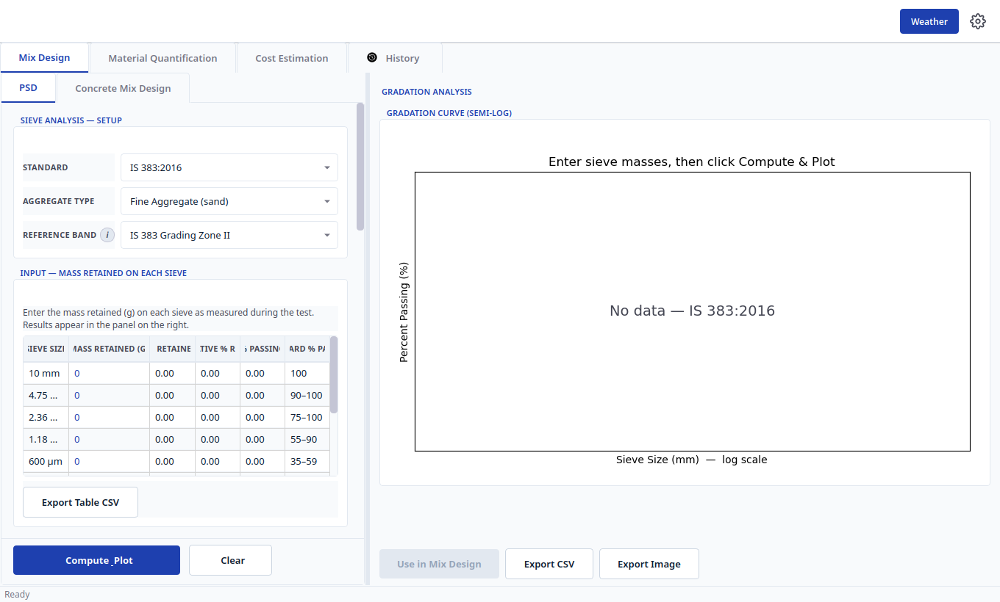
## 3. `Mix Design → PSD` (sieve analysis)

Do PSD **before** mix design when you have lab sieving data: its `Use in Mix Design` fills FM / zone / %passing-600µm for you.

### 3.1 Group: `Sieve Analysis — Setup` (`psd_widget.py:1516`)

| Label | Widget + items | What to do |
|---|---|---|
| `Standard` | Combo: `IS 383:2016`, `ASTM C33/C33M`, `BS 882:1992` | Pick the code you will claim compliance with. This changes both sieve rows and limits. NEVER mix series: IS sieves with ASTM limits is invalid. |
| `Aggregate Type` | Combo: `Fine Aggregate (sand)`, `Coarse Aggregate (gravel/stone)` | Sand → fine bands; stone/gravel → coarse bands. |

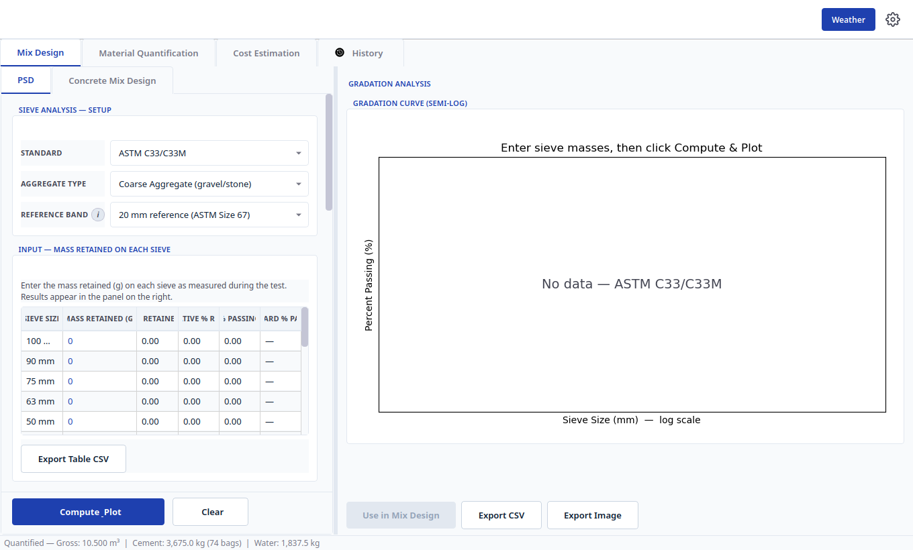
| `Reference Band` | Combo, context-dependent (this **is** the nominal-size selector; there is no separate NMSA combo here) | Pick the exact band to check against (below). ⓘ tooltip: `Limits and sieve rows always follow the selected standard...` |

`Reference Band` contents by context:

- IS 383 fine: `IS 383 Grading Zone I/II/III/IV` (default Zone II).
- IS 383 coarse: `Graded — {nominal} mm nominal (IS Table 7)`, `Single-sized — {nominal} mm nominal (IS Table 7)` (default 20 mm graded).
- ASTM fine: `ASTM C33 Fine Aggregate (Table 1)` only.
- ASTM coarse: `10 mm reference (ASTM Size 8)`, `20 mm reference (ASTM Size 67)`, `40 mm reference (ASTM Size 467)` (default 20 mm). These are the only three ASTM coarse bands the app supports.
- BS 882 fine: `BS 882 Table 4 — Overall/C/M/F`. C/M/F are **overlapping additional limits** on top of Overall, not IS-style zones.
- BS 882 coarse: `BS 882 graded/single {size} mm (Table 3)`.

BS coarse apertures are 50 / 37.5 / 20 / 14 / 10 / 5 / 2.36 mm; BS sand is 10 / 5 / 2.36 / 1.18 / 0.600 / 0.300 / 0.150 mm. The BS plot is linear-aperture by app policy, not log; IS/ASTM plots stay semi-log.

### 3.2 Group: `Input — Mass Retained on Each Sieve` (`psd_widget.py:1566`)

Hint: `Enter the mass retained (g) on each sieve as measured during the test. Results appear in the panel on the right.`

Table columns (exact headers):

1. `Sieve Size`
2. `Mass Retained (g)` — the only editable column. Type each retained mass in grams; default `0`. Leave a sieve at `0` when nothing was retained; use the `Pan (passing finest)` row for material passing the finest sieve.
3. `% Retained` (computed, default `—`)
4. `Cumulative % Retained` (computed)
5. `% Passing` (computed)
6. `Standard % Passing` (the band limit for that sieve; dash/blank = no requirement — kept for input but excluded from pass/fail)

Special rows: `Pan (passing finest)` (editable mass) and `Total Mass` (`0 g` until computed).

Button under the table:

- `Export Table CSV` — tooltip: `Save the sieve table above to a CSV file (Sieve Size, Mass Retained, % Retained, Cumulative % Retained, % Passing and Standard % Passing). Only sieves with a grading requirement in the selected band are exported; sieves with no requirement (dash/blank) are stripped. Pan/Total always kept and cover the full stack.` Use this to archive the raw grading before computing.

### 3.3 Group: `Quality Requirements`

Title retitles at runtime to `ASTM C33 Quality Requirements` or `IS 383 Quality Requirements`. Hint: `Enter the laboratory results for the clauses you want checked; fields left at "not tested" are skipped.`

Eachspin shows `not tested` at its minimum. Leave untouched any clause you did not test — it reports `— n/a`, not fail. Entering a value activates that clause (deleterious substances, soundness, organic impurities, etc.). Tooltips on each row give the clause number.

### 3.4 Action row (pinned below the table)

| Button | Action |
|---|---|
| `  Compute & Plot` (two leading spaces) | Validates masses, computes % retained / cumulative / passing, FM where applicable, D10/D30/D60/Cu/Cc, checks the band, draws the curve. No tooltip. |
| `  Clear` | Resets all masses to `0`, clears results, disables the three right-panel buttons. |

### 3.5 Right panel: `Gradation Analysis`

- Group `Results Summary` (hidden until computed). Stat cards: `Fineness Modulus`, `D10`, `D30`, `D60`, `Cu (Uniformity)`, `Cc (Curvature)`, `% Passing 600 µm (DOE)`, `Total Mass`. Badge is exactly one of: `✓ Conforms to selected band`, `✗ {n} sieve(s) out of band`, `— No band to check`.
- Group `Gradation Curve (Semi-Log)` — retitled `Gradation Curve (Linear — BS display policy)` for BS 882. Empty text: `Enter sieve masses, then click Compute & Plot`. Out-of-band sieves get predicted corrective text in the corrections label.
- Group `Fineness Modulus — from Sieve Analysis (ACI 211.1-22 §4.3.5)` (hidden until computed). Headers `Sieve` / `Cumulative % Retained`; missing rows show `— not included`; footers `Σ  sum of cumulative % retained` and `FM = Σ ÷ 100`. FM-ok note ends with `Press "Use in Mix Design" ...`; FM-missing note lists which sieves to add.
- Bottom buttons (all disabled until a successful compute; `Clear` disables them again):
  - `Use in Mix Design` — tooltip lists the three code routings (ACI FM → Table 5.3.6; IS zone → Table 5; DOE %passing-600µm → Figure 6; BS also carries lab record). Fills the mix form and switches to `Concrete Mix Design`. For BS 882 the button stays disabled until the lab-record checks pass.
  - `Export CSV` — saves the computed grading.
  - `Export Image` — saves the curve PNG.

### 3.6 Non-conformance dialog (`{standard} Compliance — Non-Conformance`)

Opens automatically from `Compute & Plot` when sieves fail. Title e.g. `ASTM C33 Compliance — Non-Conformance`. Banner: `⚠ {n} requirement(s) NOT met — the {fine aggregate|coarse aggregate} analysis does not conform to {standard_name}.` Table headers: `Status` / `Clause` / `Requirement` / `Result / measured value`. Status cells: `✗ NOT MET`, `✓ Meets`, `— n/a`. Footer cites the extracted edition (IS 383 Third Rev + Amd 1; ASTM C33-99ae1). Only button is `OK`.

Typical PSD workflow:

1. `Mix Design → PSD`.
2. Set `Standard`, `Aggregate Type`, `Reference Band`.
3. Type every `Mass Retained (g)` + Pan.
4. Optional: `Export Table CSV`.
5. `Compute & Plot` → read badge + curve.
6. `Use in Mix Design` (or fix grading and recompute).

---

## 4. `Mix Design → Concrete Mix Design` — Step 1 `Step 1 — Design Parameters`

### 4.1 `Standard` and `Calculation`

| Label | Items | Effect |
|---|---|---|
| `Standard` | `ACI PRC-211.1:2022`, `IS 10262:2019` (default), `DOE (BRE 331:1997)` | Switches the whole form: which groups/fields show, which tables the engine uses, which units the result prints. |
| `Calculation` | `Concrete Mix Design` (default), `Target Strength` | `Concrete Mix Design` → full proportions. `Target Strength` → only the code target-mean-strength panel; W/C, quantities, ratio are not calculated. The blue action button relabels to `  Calculate Target Strength` in this mode. |

### 4.2 Common fields (all standards)

| Label | Widget / range / default | Meaning |
|---|---|---|
| `Characteristic Strength fck (MPa)` | spin 5–100, default 25.0 | 28-day characteristic strength (fck / f'c / fc). ⓘ: `Any grade 5–100 MPa. Durability is gated by the exposure selection...` |
| `Slump (mm)` → `Slump (in)` under Imperial | IS/ACI 10–250 default 75.0; DOE 0–180 | Workability. DOE also accepts Vebe instead (below). |
| `NMSA` | `10 mm`, `12.5 mm` (IS only), `20 mm` (default), `40 mm`, plus `80 mm (mass)` / `150 mm (mass)` for IS mass route | Nominal maximum size. Must respect form/slab/bar limits (1/5 form width, 1/3 slab, 3/4 bar spacing — the three ACI-only check fields). |
| `Water Content (kg/m³)` | display `—` until calculated | Live baseline from NMSA + slump + aggregate type (auto-updates; not typed). |
| `Volume (m³)` | spin 0.01–1000, default 1.0 | Concrete volume to scale the result. Use 1.0 for per-m³ design. |
| `Cement Type` | IS/DOE labels: `32.5R (OPC 33)` / `42.5R (OPC 43)` / `42.5N (OPC 43)` / `52.5N (OPC 53)`; ACI labels: `32.5R (Type I)` / `42.5R (Type III)` / `42.5N (Type I)` / `52.5N (Type I)`; default `42.5R` | Strength class. Same GRADE_* engine values; label only changes. |
| `Project Name` (in `Report Details`) | text, placeholder `e.g., Terminal 3 Expansion — leave blank for N/A` | Header only; never sent to the engine. Date is auto-stamped on export. |

### 4.3 IS-only fields (`Standard = IS 10262:2019`)

| Label | Items / default | Notes |
|---|---|---|
| `Concrete Type` | `Reinforced Concrete` (default), `Plain Concrete` | Selects which IS 456 Table 5 row applies. |
| `Exposure Class (IS 456)` | `None` (default), `Mild`, `Moderate`, `Severe`, `Very Severe`, `Extreme` | Drives the `Max Free W/C Ratio` display `W/C ≤ x.xx  |  Min Grade: ...`. |
| `Max Free W/C Ratio` | display `—` | Read-only durability cap from Concrete Type × Exposure. |
| `Placing Method` | `Chute (non-pumpable)` (default), `Pumping` | `Pumping` (or congested steel) reduces Table 5 CA fraction (§5.5.2). |
| `Pump CA Reduction` | `Auto` checkbox (checked) + spin 0–10 % default 10.0, disabled while Auto is on | Auto = 10 % ordinary / 5 % high-strength. Uncheck to type an explicit % (rejected above the route max; mass sizes need explicit %). Only honoured when `Placing Method = Pumping`. Tooltip: `Checked: 10% ordinary / 5% high-strength (worked-example values). Unchecked: use the explicit % beside it.` |
| `Site Control` | `Good site control` (default), `Fair site control (+1 MPa SD)` | Fair adds 1 MPa to assumed SD (Table 2 Note 1). |
| `Mass Concrete` | bare checkbox, visible label `Mass Concrete` | Dams/rafts/mass pours; uses Table 12 water. Tooltip: `Mass concrete (IS 10262 §9): dams, rafts, mass pours — uses Table 12 water content.` |
| `Aggregate Shape` (Step 2 but IS-gated) | `Rounded Gravel`, `Gravel`, `Sub Angular`, `Angular` (default), `Crushed Fragments` | Table 6 water demand. |
| `Grading Zone` ↔ `CA Volume Fraction (Table 5)` (Step 2, IS-gated swap) | Zone `I/II/III/IV` (default II) **or** `Zone X — f.ff` rows when NMSA is tabulated | Only one shows at a time. The visible Table 5 row drives the zone the engine consumes. |
| `Admix. Water (kg/m³)` (Step 3, IS-gated) | spin 0–50, default 0.0 | Liquid-admixture water counted in W/C at durability limits (Cl. 5.1 note). 0 = none/included. |


### 4.4 ACI-only fields (`Standard = ACI PRC-211.1:2022`)

Checkboxes are bare boxes with the visible label beside them.

| Label | Widget | Notes |
|---|---|---|
| `Air Entrainment` | bare checkbox | Freeze-thaw air (Table 5.3.3). Tooltip: `Air-entrained concrete for freeze-thaw exposure (ACI 211.1).` |
| `Sulfate Exposure` | `S0 — None` (default), `S1 — Moderate`, `S2 — Severe`, `S3 — Very Severe` | Table 6.3.4(b) max W/C. |
| `Freezing Exposure` | `F0 — Not exposed` (default) … `F3` | Durability. |
| `Water Exposure` | `W0 — Dry` (default), `W1`, `W2 — Water barrier` | Permeability. |
| `Corrosion Exposure` | `C0 — Dry` (default), `C1`, `C2 — External chlorides` | Chloride scope. |
| `Prestressing` | bare checkbox | Prestressed steel present; narrows chloride scope. |
| `Has Production Data (≥30 tests)` | checked checkbox (ACI-only; hidden otherwise) | On = σ ≈ 3.5 MPa assumed; off = higher overdesign. |
| `Strength Tests (n)` | spin 15–1000, default 30 | Number of prior tests for overdesign. |
| `Std Deviation s (MPa)` | spin 0–10, default 0.0 | 0 = engine default 4.0 MPa. |
| `Rounded aggregate −8% water (Table 5.3.3.1)` | unchecked checkbox | −8 % water cut for rounded CA. Off unless the trial verifies it (Example 2 vs Example 1). |
| `Target Paste Volume (%)` | spin 0–45, default 0.0 | 0 = off. Example 4 route; AASHTO PP 84 cites 25 %. |
| `Concrete Temp (°C)` | spin −10–60, default 22.5 | 22.5 = baseline; hot/cold shifts water. |
| `Form Width (narrowest)`, `Slab Depth`, `Clear Bar Spacing (min)` | spins, default 0.0 | 0 = skip the NMSA-limit check. Otherwise NMSA must satisfy 1/5 / 1/3 / 3/4 rules. |
| `Fineness Modulus`, `Manufactured Sand`, `Dry-Rodded Bulk Density` | Step 2, ACI-gated — see §5.1 | |
| `Trial Check (optional) — ACI §5.3.10` group | Step-3-adjacent, ACI-gated — see §6.1 | |


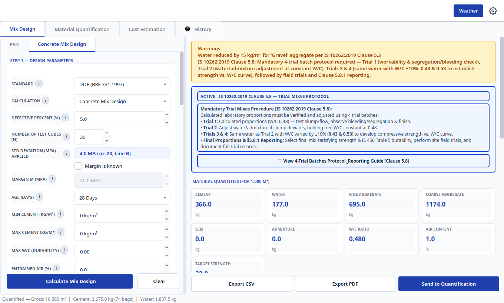
### 4.5 DOE-only fields (`Standard = DOE (BRE 331:1997)`)

| Label | Widget / default | Notes |
|---|---|---|
| `Defective Percent (%)` | spin 1–10, default 5.0 | Defective rate for margin (C2). Deactivated when `Margin is known` is on. |
| `Number of Test Cubes (n)` | spin 1–200, default 20 | n < 20 → Line A (s = 0.4×fc or 8 MPa); n ≥ 20 → Line B (0.2×fc or 4 MPa). |
| `Std Deviation (MPa) — Applied` | display `—` | Read-only s actually applied; shows `—  (Margin M known — s not used)` when overridden. |
| `Margin is known` | unchecked checkbox | On: `Defective %`, `Number of Test Cubes`, applied-SD deactivate; target fm = fc + `Margin M`. |
| `Margin M (MPa)` | spin 0.5–40, default 10.0, disabled until checked | Known margin from site records (§4.4, C2). |
| `Age (Days)` | `3 Days`, `7 Days`, `28 Days` (default), `91 Days` | Strength-age for Figure 4. |
| `Min Cement (kg/m³)` / `Max Cement (kg/m³)` | spins 0–1000, default 0.0 | 0 = no limit. Durability/economy caps. |
| `Max W/C (Durability)` | spin 0–1, default 0.00 | 0 = no override. Caps the Figure 4 W/C. |
| `Entrained Air (%)` | spin 0–10, default 0.0 | Freeze-thaw air. |
| `Vebe Time (s)` | spin 0–120, default 0.0 | 0 = use slump. Non-zero re-points slump to the governing class representative and selects the Table 3 / Figure 6 class. |
| `Workability Range (DOE)` | `Slump {slump} (Vebe {vebe}) — {w} kg/m³` rows | Built from WORKABILITY_CLASS_INFO; labels rewrite live with Table 3 water. Classes: 0 = Slump 0–10 mm / Vebe >12 s; 1 = 10–30 / 6–12; 2 = 30–60 / 3–6; 3 = 60–180 / 0–3. |
| `FA Passing 600 µm (%) *` | spin 0–100, default 60.0 | Required. Sand grading entry to Figure 6. |
| `Figure 6 Fine Agg. (%)` | display `—` | Live Figure 6 readout for current form values (step 11 preview; result is authoritative). |
| `Fine Aggregate Type` | `Uncrushed (Natural Sand)` (default), `Crushed (Crushed Rock Sand)` | Table 3 water. Mixed FA/CA types use W = 2/3 Wf + 1/3 Wc. |
| `Coarse Aggregate Type` | `Uncrushed (Gravel)` (default), `Crushed (Crushed Rock)` | Table 2 reference strength + Table 3 water. |
| `Aggregate Rel. Density (SSD)` | spin 0–3.5, `Auto` at 0 | Auto = mean of FA/CA SG (Item 4.1). Type a tested Item 4.1 value or leave Auto. |
| `CA Split (single sizes)` | `Single stock (no split)` (default), `10 + 20 mm  (1 : 2)`, `10 + 20 + 40 mm  (1 : 1.5 : 3)` | §5.5 subdivision. 10+20 needs 20 mm NMSA; triple needs 40 mm. |

---

## 5. Step 2 `Step 2 — Material Properties`

### 5.1 Cement + fine aggregate (all standards unless noted)

| Label | Range / default | Notes |
|---|---|---|
| `Cement Type` | see §4.2 | Grade labels adapt to Standard. |
| `Cement Specific Gravity` | 2.8–3.5, default 3.15 | OPC = 3.15. V = mass/(SG×1000) metric, mass/(SG×62.4) ACI. |
| `Fine Aggregate SG` | 2.2–3.0, default 2.65 | SSD relative density. Typical 2.50–2.75. |
| `Fineness Modulus` (ACI only) | 1.0–4.0, default 2.70 | Σ retained/100. Coarse 2.8–3.2, medium 2.4–2.8, fine 2.0–2.4. Fill from PSD `Use in Mix Design` when available. |
| `Manufactured Sand` (ACI only) | bare checkbox | Adds 5 % water (Table 5.3.3.1). |
| `Grading Zone` / `CA Volume Fraction (Table 5)` (IS only, swapped) | see §4.3 | |
| `FA Passing 600 µm (%) *` + `Figure 6 Fine Agg. (%)` (DOE only) | see §4.5 | |
| `Fine Aggregate Type` (DOE only) | see §4.5 | |
| `FA Absorption (%)` | 0–10, default 1.0 | SSD absorption (IS 2386 / ASTM C128). Typical 0.5–3 %. |
| `FA Free Moisture (%)` | 0–20, default 0.0 | + = wet (cuts mixing water); 0 = SSD; field negatives handled as dry where the engine allows. |

### 5.2 Coarse aggregate

| Label | Range / default | Notes |
|---|---|---|
| `Coarse Aggregate SG` | 2.2–3.2, default 2.70 | Granite 2.65–2.80, limestone 2.50–2.70, basalt 2.80–3.00. |
| `Coarse Aggregate Type` (DOE only) | see §4.5 | |
| `Aggregate Shape` (IS only) | see §4.3 | |
| `Dry-Rodded Bulk Density` (ACI only) | 1000–2000, default 1600 | ASTM C29 DRUW × Table 5.3.6 fraction = CA weight. Typical 1400–1750. |
| `Aggregate Rel. Density (SSD)` (DOE only) | `Auto` | see §4.5. |
| `CA Absorption (%)` | 0–10, default 0.5 | Typical 0.2–2 %. |
| `CA Free Moisture (%)` | 0–20, default 0.0 | Same sign convention as FA. |
| `CA Split (single sizes)` (DOE only) | see §4.5 | |

---

## 6. Step 3 + optional groups + action bar

### 6.1 Group: `Step 3 — Admixtures & SCM`

| Label | Items / range | Notes |
|---|---|---|
| `SCM Type` | Base: `None` (default), `Fly Ash`, `GGBFS`, `Metakaolin`, `Silica Fume`. Labels gain code suffixes per Standard (IS: `Fly Ash (IS 3812 Part 1)` etc.; ACI: `Fly Ash Class F/C (ASTM C618)`, `Slag Cement / GGBFS (ASTM C989)`, `Silica Fume (ASTM C1240)`; DOE: `Pulverised-Fuel Ash / pfa (BS 3892 / BS EN 450)`, `Ground Granulated Blastfurnace Slag / ggbs (BS 6699)`). | Fly ash 15–30 % (max 35 structural); GGBFS 30–70 %; silica fume 5–10 %. |
| `SCM Replacement (%)` | 0–60, default 0.0 | % cement replaced by weight. Auto-fills SG on selection; adjust to tested value. |
| `SCM Specific Gravity` | 1.5–4.0, default 2.20 | Fly ash 2.20, GGBFS 2.90, silica fume 2.20 typical. |
| `Admixture Type` | Base: `None` (default), `Superplasticizer`, `Plasticizer`, `Retarder`, `Accelerator`, `Air-Entraining`. Per-standard labels: IS adds `(PCE / SNFC / SMFC)`, `(Lignosulfonate)` etc.; ACI uses `Type A — Water-Reducing (min 5%)` … `Type F — High-Range Water-Reducing / HRWRA (12–40%)`, `Type G`, `Air-Entraining (ASTM C260)`; DOE uses `Water-Reducing (Plasticiser)`, `High-Range Water-Reducing (Superplasticiser)`, retarding/accelerating variants. | Superplasticizer 15–30 % water cut; plasticizer 8–15 %; PCE 30 %+; retarder/accelerator/air-entraining 0 % baseline unless tested. |
| `Dosage (% by wt. cement)` | 0–5, default 1.0 | Plasticizer 0.3–0.5, superplasticizer 0.5–1.5, PCE 0.3–0.8. |
| `Water Reduction (%)` | 0–40, default 0.0 | Applied to base water. 10 % cut ≈ 15 % strength gain (Abrams). Per-code tooltip text. |
| `Admixture SG` | 1.0–1.5, default 1.15 | Liquid SG for absolute volume. Typical 1.05–1.25. |
| `Admix. Water (kg/m³)` (IS only) | 0–50, default 0.0 | Water carried in liquid admixture; counted in W/C at durability limits. |
| `Reduced Water (kg/m³)` | display `—` | Read-only: Base water × (1 − reduction/100). Used for cement content. |

Changing admixture type/dosage auto-recomputes `Reduced Water`.

### 6.2 Group: `Trial Check (optional) — ACI §5.3.10` (ACI only)

All 0 = not measured. Enter measured values to get §5.3.10 post-trial adjustments at design scale.

| Label | Range | Effect |
|---|---|---|
| `Trial Density (measured)` | 0–3000 | ASTM C138 fresh density → yield check Ry = design/actual (tolerance 0.98–1.02). |
| `Trial Slump (measured)` | 0–250 | Re-estimates water ±10 lb/yd³ per inch (§5.3.10.1). Needs trial density. |
| `Trial Air % (measured)` | 0–15 | ∓5 lb/yd³ per 1 % air (§5.3.10.2). Air-entrained only. |
| `Trial Strength (measured)` | 0–120 | Re-estimates cement via efficiency, W/C held (§5.3.10.3). |

This group feeds design-time steps 10.1–10.4. The full batch-scale workbook is the `🧪 Open Trial Batching Workbook (§5.3.9–5.3.10)` button on the result (§7.2).

### 6.3 Group: `SCC Checks (optional, IS)` (IS only)

Tooltip: `SCC fresh-property checks (IS only): slump-flow class (§7.2.1), L-box (§7.2.2), segregation SR (§7.2.3) and V-funnel (§7.2.4) per IS 1199 (Part 6).`

| Label | Items / range |
|---|---|
| `SCC Target Class` | `None` (default), `SF1 — 550–650 mm`, `SF2 — 660–750 mm`, `SF3 — 760–850 mm`. Any selection activates §§7–8 checks. |
| `Slump-Flow (measured, mm)` | 0–1000, default 0.0 (0 = not measured). Checked against the class (§7.2.1). |
| `L-Box Ratio (measured)` | 0–1, default 0.0. Minimum 0.80 (§7.2.2). |
| `Segregation SR % (measured)` | 0–100, default 0.0. SR1 15–20 %, SR2 <15 % (§7.2.3). |
| `V-Funnel Time (measured, s)` | 0–120, default 0.0. V1 ≤ 8 s, V2 8–25 s (§7.2.4). |

### 6.4 Group: `Report Details`

Only `Project Name` (see §4.2). Never affects numbers.

### 6.5 Action bar (pinned below the scroll)

| Button | Behaviour |
|---|---|
| `  Calculate Mix Design` / `  Calculate Target Strength` | Runs the engine. Relabels to `  Calculating...` and disables `Calculation` while busy. On success shows the matching result page + saves to History. |
| `  Clear` (secondary) | Resets the whole mix form to defaults, clears both result panels. |

---

## 7. Mix results (right pane)

### 7.1 `Target Strength` panel (`Target Strength` + subtitle `Standard-based target mean strength. Mix proportions are not calculated in this mode.`)

Cards: `Characteristic Strength`, `Standard Deviation` (`—` / `not used` when margin-known or N/A), `Strength Margin`, `Target Mean Strength`. Formula + `Reference: ...` lines cite the clause. `Calculate a target strength to see the result.` shows before calculation.


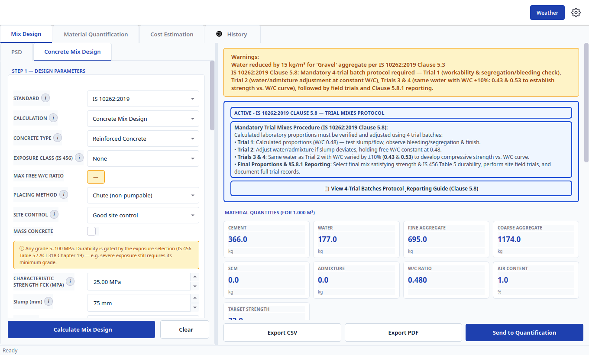
### 7.2 `ResultPanel` (full mix)

Sections in order:

1. Trial protocol card (only the card matching the result standard shows):
   - `IS 10262:2019 Clause 5.8 — Trial Mixes Protocol` + `📋 View 4-Trial Batches Protocol & Reporting Guide (Clause 5.8)`.
   - `BRE 331:1997 §6 — Trial Mixes` + `🧪 Open Trial Mixes Workbook (§6)`.
   - `ACI PRC-211.1-22 — Trial Batching` + `🧪 Open Trial Batching Workbook (§5.3.9–5.3.10)`.
2. `Target Strength Estimation` — fm, margin, formula.
3. `Material Quantities (per m³)` — retitled `Material Quantities (for {vol} {unit})` when Volume ≠ 1. Cards: `Cement`, `Water`, `Fine Aggregate`, `Coarse Aggregate`, `SCM`, `Admixture`, `W/C Ratio`, `Air Content`, `Target Strength` (each `—` until calculated; hover shows value + unit).
4. DOE `CA Split` rich-text line when a split is active.
5. `Calculation Steps` — step-by-step clause tree.
6. `Warnings:` banner when exposure/durability caps bind.
7. `Mix ratio` label + per-volume reference line.

Bottom buttons (disabled until a result exists):

| Button | Action |
|---|---|
| `Export CSV` | Save quantities + steps CSV (parent `_export_csv`). |
| `Export PDF` | Open `ReportPreviewDialog`, then save PDF with header, inputs, curve, steps. |
| `Send to Quantification` | Push the result to `Material Quantification` (§10). |

### 7.3 Trial workbooks (opened from §7.2 trial-card buttons)

Only the card matching the result standard is shown, titled `ACTIVE - ...` (accent border). Each workbook is a modal dialog with scrollable content and a `Close` button (default). IS sizes 880×680 (min 700×520); ACI/DOE 940×760 (min 760×560).

### 7.3.1 IS workbook (`IS 10262:2019 Clause 5.8 — Trial Mixes Protocol & Reporting`)

Launch: `📋 View 4-Trial Batches Protocol & Reporting Guide (Clause 5.8)` (exact source string uses `_Reporting`; the rendered card shows a space).

Header `IS 10262:2019 Section 5.8 — Trial Mixes Procedure`: `The calculated mix proportions shall be checked by means of trial batches in the laboratory. Four trial mixes are prepared to adjust workability and establish the relationship between compressive strength and water-cement ratio before finalizing production proportions.`

Group `Mandatory 4-Trial Batches Schedule (Clause 5.8)` — read-only table, columns `Trial Batch` / `W/C` / `Ratio (C:FA:CA)` / `Water (kg)` / `Water Vol (L)` / `Cement (kg)` / `SCM (kg)` / `Fine Agg (kg)` / `Coarse Agg (kg)` / `Admixture (kg)`. Rows:

| Row | Content |
|---|---|
| `Trial 1: ... (Calculated Design Proportions)` | Design W/C and quantities; measure slump/flow, check segregation/bleeding/finish. |
| `Trial 2: ... (Workability-Adjusted Baseline)` | Same W/C; adjusted water/admixture baseline for Trials 3–4. |
| `Trial 3: ... (W/C -10%: ...)` | Same water, more cementitious; cast 150 mm cubes (7 + 28 d). |
| `Trial 4: ... (W/C +10%: ...)` | Same water, less cementitious; verify IS 456 minimum cement. |

Group `Clause 5.8 Step-by-Step Lab & Field Procedure`: numbered steps 1–4 (initial batch per IS 1199 slump; Trial 2 holds free W/C constant at the design value; Trials 3–4 vary W/C ±10 %; plot strength vs. W/C, select optimum, run site field trials).

Group `Clause 5.8.1 Mandatory Reporting Checklist`: intro `Ensure the final mix design report includes all mandatory items required by IS 10262:2019 Clause 5.8.1:` plus pre-checked boxes `(a) Period of testing (starting and ending date)` / `(b) Details of work / type of structure` / `(c) All mix design input data as per Clause 4.1 & IS 456 deviations` / `(d) Relevant test data of different materials (aggregates, cement, water, admixtures)` / `(e) Details of materials (brand of cement, mfg date/week, % pozzolana/slag, aggregate sources)` / `(f) Details of the 4 trial batches conducted (workability, bleeding, cube compressive strengths)` / `(g) Recommended final mix proportions and field trial validation records`.

Buttons: `Copy Trial Batches to Clipboard`, `Export Trial Batches (CSV)`, `Close`. No history save — IS trials travel inside the mix report/PDF.

### 7.3.2 DOE workbook (`DOE (BRE 331:1997) §6 — Trial Mixes Workbook`)

Launch: `🧪 Open Trial Mixes Workbook (§6)`. Header `BRE 331:1997 §6 — Trial Mixes` (0.05 m³ batch → six 150 mm cubes + slump/Vebe + density; §6.3 adjustments: Table 3 workability, density correction, Figure 7 w/c).

Group `Trial Batch Schedule (§6.1)`: `Trial volume (m³):` (0.005–0.500, default 0.05; tooltip: §6.1 six-cube requirement), `Add ±w/c variant batches` checkbox + `w/c step:` (0.01–0.10, default 0.05), `Aggregate moisture condition (BS 1881 Part 125):` combo (`Saturated surface-dry (design basis)` default, `Oven-dry`, `Air-dried`, `Surface-wet / saturated`). Table columns: `Trial Batch` / `W/C` / `Cement (kg)` / `Water added (kg)` / `Fine Agg (kg)` / `Coarse Agg (kg)` / `Admixture (kg)` + grey schedule note.

Group `Trial Results & §6.3 Adjustments`: `Water actually added (kg):`, `Measured slump (mm):` (BS 1881:Part 102), `Vebe (s):` (Part 104), `Fresh density (kg/m³):` (Part 107), `Mean cube strength (MPa):` (Part 116), `Test age (days):` (3–91, defaults to the design age), then `Calculate Adjustments` → rich-text §6.3 evaluation (blank spins show `—` and are skipped).

Group `Tests on Trial Mixes — §6.2 Checklist`: intro `Tests on the fresh concrete, specimen making, curing and testing follow BS 1881. Record the actual water/cement ratio used, the fresh density and all cube results.` plus pre-checked `Preparation of trial mixes — BS 1881:Part 125 (BRE 331:1997 §6.1)` / `Slump test — BS 1881:Part 102 (BRE 331:1997 §6.2)` / `Vebe time test — BS 1881:Part 104 (BRE 331:1997 §6.2)` / `Density (fresh concrete) — BS 1881:Part 107 (BRE 331:1997 §6.2)` / `Making test cubes — BS 1881:Part 108 (BRE 331:1997 §6.2)` / `Normal curing — BS 1881:Part 111 (BRE 331:1997 §6.2)` / `Compression testing of cubes — BS 1881:Part 116 (BRE 331:1997 §6.2)`.

Buttons: `Save Trial Record`, `Copy Schedule to Clipboard`, `Export Workbook (CSV)`, `Close`. `Save Trial Record` writes a `DOE Trial Mix` (`doe_trial`) history entry — view-only (`Load into Tab` hidden, §12).

### 7.3.3 ACI workbook (`ACI PRC-211.1-22 — Trial Batching Workbook`)

Launch: `🧪 Open Trial Batching Workbook (§5.3.9–5.3.10)`. Header `ACI PRC-211.1-22 — Trial Batching (Ch. 8, §5.3.9–5.3.10)` (batch per ASTM C192 with §5.3.9.1 moisture adjustments, test per C143/C138/C173/C231, enter measurements for §5.3.10 next-trial proportions).

Group `Batch Weight Summary (§5.3.9, Table 5.3.9.1)`: `Trial volume (m³):` (0.005–0.500, 4 dp, default 0.05; tooltip: §9.2.9 reference trial is 1 ft³ = 0.0283 m³, quantities scale linearly), `Add A.5 trial series (±cementitious)` checkbox (Appendix A.5 three-point w/cm–strength curve at constant water) + `Cement step (%):` (1–50, default 10.0). Table columns: `Mixture` / `w/cm` / `Water to batch (kg)` / `Cementitious (kg)` / `Fine Agg batched (kg)` / `Coarse Agg batched (kg)` / `Admixture (kg)` + schedule note.

Group `Trial Results & §5.3.10 Post-Trial Adjustments`: `Water actually added (kg):`, `Batched Fine Agg (kg):`, `Batched Coarse Agg (kg):` (blank = scheduled), `Measured slump (mm):` (C143), `Fresh density (kg/m³):` (C138), `Air content (%):` (C231/C173), `Strength (MPa):`, `Age (d):` (1–91, default 28), then `Calculate Adjustments` (net-water ± yield ± 10 lb/yd³ per inch of slump, air correction, cement efficiency).

Group `Trial Batch Tests — ASTM Checklist (Ch. 8 / §5.3.10)`: intro (ASTM C192 batching by certified personnel; record water added, batched masses, slump, density/yield, air, strengths) plus pre-checked `Preparation of trial batches — ASTM C192/C192M (ACI PRC-211.1-22 Ch. 8, §5.3.10)` / `Temperature of fresh concrete — ASTM C1064/C1064M (Ch. 8)` / `Slump — ASTM C143/C143M (Ch. 8, §5.3.10)` / `Density (yield) of fresh concrete — ASTM C138/C138M (§5.3.10, §4.7.9)` / `Air content — volumetric — ASTM C173/C173M (§5.3.10)` / `Air content — pressure method — ASTM C231/C231M (§5.3.10)` / `Making and curing specimens — ASTM C31/C31M (Ch. 8 curing guidance)`, then the Table 8 (Kosmatka and Wilson 2016) guidance note: one-constituent-at-a-time re-trial until all requirements are within tolerance.

Buttons: `Save Trial Record`, `Copy Schedule to Clipboard`, `Export Workbook (CSV)`, `Close`. Saves an `ACI Trial Mix` (`aci_trial`) view-only history entry.

Typical mix workflow:

1. `Mix Design → Concrete Mix Design`.
2. Set `Standard` + `Calculation`.
3. Fill Step 1 → Step 2 → Step 3 (only visible rows apply).
4. Optional: Trial Check / SCC / `Project Name`.
5. `Calculate Mix Design` → read cards + steps + warnings.
6. `Export CSV` / `Export PDF` to archive; `Send to Quantification` to continue; trial-workbook button when batching.

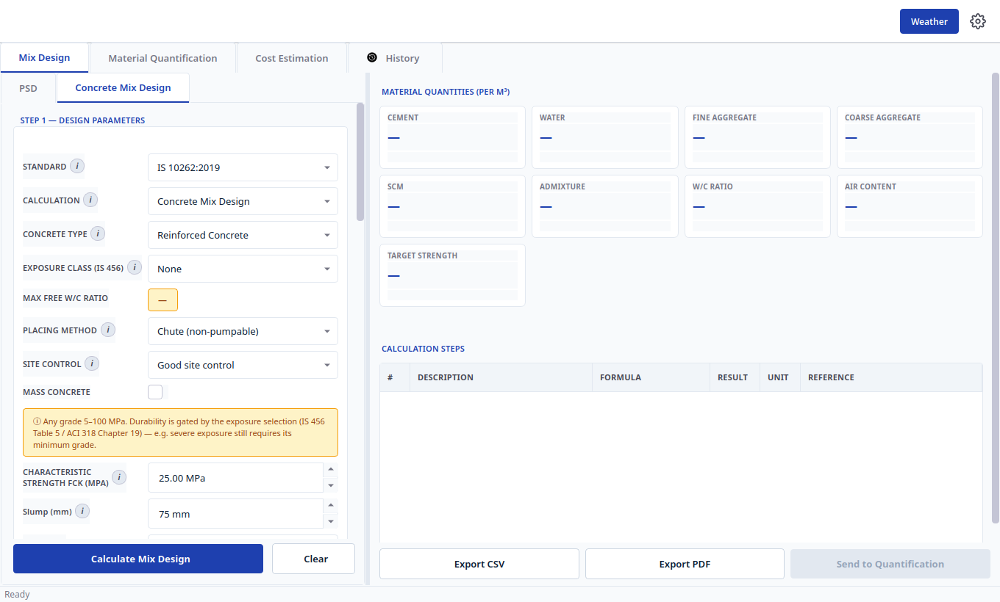
---

## 10. `Material Quantification` tab

Layout: horizontal splitter — left sub-tab widget (input forms) + right `QuantResultPanel` (results). Two left sub-tabs.

Status banners:
- Subtab 1 default: `Standalone mode — enter mix parameters manually.`
- After `Send to Quantification`: `Loaded: {code} | f'cr={...} {unit} | W/C={...:.3f} | Cement={...:.1f} ...` (green).
- After history load: `Loaded from history: {code} | f'cr={...} {unit} | W/C={...:.3f} | Cement={...:.1f} ...` (green).
- Subtab 2 (`Mix Ratios & Volume`) banner: `Mix Ratio Mode — enter mix proportions (Cement : Sand : Coarse Agg) and work volume. Note: 1 bag of cement = 0.035 m³.`


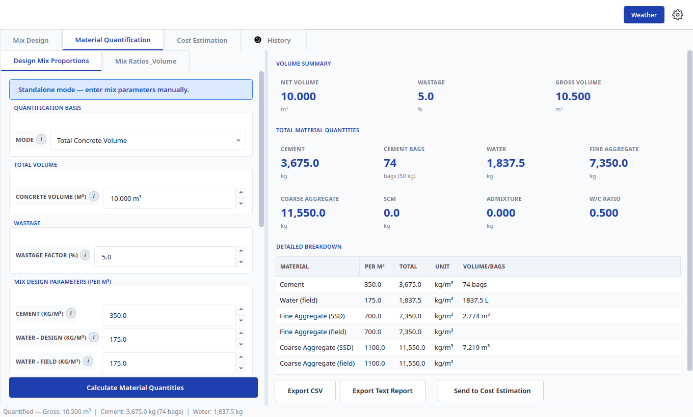
### 10.1 Subtab: `Design Mix Proportions` (designed-mix bill)

| Group | Labels + defaults | Use |
|---|---|---|
| `Quantification Basis` | `Mode`: `Total Concrete Volume` (data `volume`, default) / `Structural Element Dimensions` (data `elements`) | `Total Concrete Volume` = type total m³ below. `Structural Element Dimensions` = reveal the `Structural Elements` table and sum it. |
| `Total Volume` | `Concrete Volume (m³)` (unit-aware → `Concrete Volume (yd³)` under Imperial), `UnitSpinBox` volume 0.01–100000, default 10.0 m³, 3 dp | Net volume; wastage added on top. |
| `Structural Elements` (hidden until `Mode = Structural Element Dimensions`) | Table headers `Type | L (m) | W (m) | D (m) | Qty | Vol (m³)` (unit-aware: `L (yd)` etc., `Vol (yd³)`); row type combo: `Footing`, `Column`, `Beam`, `Slab`, `Wall`, `Custom`; buttons `Add Element` → append row, `Remove Selected` → delete selected rows; footer `Total: 0.000 m³` (runtime `Total: {x:.3f} {unit}`) | Element take-off. `Add Element` then set Type + L/W/D + Qty per row. |
| `Wastage` | `Wastage Factor (%)`, 0–30, default 5.0 %, step 0.5, 1 dp | Added to net. 3–5 % ready-mix, 5–10 % site-mixed. |
| `Mix Design Parameters (per m³)` | `Cement (kg/m³)` default 350.0; `Water - design (kg/m³)` 175.0; `Water - field (kg/m³)` 175.0; `Fine Agg - SSD (kg/m³)` 700.0; `Fine Agg - field (kg/m³)` 700.0; `Coarse Agg - SSD (kg/m³)` 1100.0; `Coarse Agg - field (kg/m³)` 1100.0; `SCM (kg/m³)` 0.0; `Admixture (kg/m³)` 0.0, 3 dp | Auto-filled by `Send to Quantification`; editable standalone. SSD = design state; field = moisture-corrected state actually batched. |
| `Mix Information` | `Code Standard`: `IS 10262` / `ACI 211.1` / `Manual` (default `Manual`); `Target Strength` default 25.0 MPa; `W/C Ratio` 0.3–0.8 default 0.5, 3 dp; `Cement Bag Weight` default 50 kg | Context for the bill; bag weight converts kg → bags. |
| `Override Mix Values (per m³)` (hidden in standalone; shown for loaded/linked mixes) | Rows: `Cement (kg/m³)`, `Water - field (kg/m³)`, `Fine Agg - field (kg/m³)`, `Coarse Agg - field (kg/m³)`, `SCM (kg/m³)`, `Admixture (kg/m³)`; tooltip: `Enable by double-clicking, then edit the value (read-only grey until enabled)`; button `Reset All Overrides` (secondary) | Temporary site adjustments without touching the base mix. Double-click a row to enable it, edit, `Reset All Overrides` to restore. |

Pinned action: `  Calculate Material Quantities` (two leading spaces) → runs worker (debounced 300 ms; relabels `  Calculating...` while busy) → bill + status `Quantified — Gross: {x:.3f} {vol} | Cement: {x,.1f} {mass} ({bags:.0f} bags) | Water: {x,.1f} {mass}` (8 s) + history save. Failure: `Quantification Error` message box.


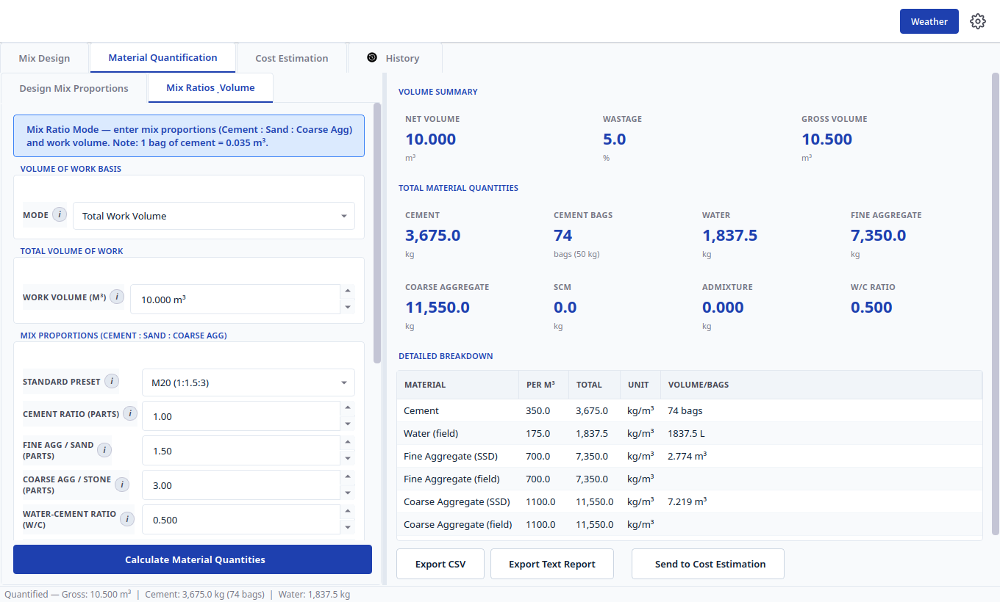
### 10.2 Subtab: `Mix Ratios & Volume` (nominal-ratio bill)

| Group | Labels + defaults | Use |
|---|---|---|
| `Volume of Work Basis` | `Mode`: `Total Work Volume` (default) / `Structural Element Dimensions` | Same pattern as §10.1. |
| `Total Volume of Work` | `Work Volume (m³)` (unit-aware), default 10.0 m³ | Net wet volume. |
| `Structural Elements` (hidden until Element mode) | Same headers/types/buttons/total as §10.1, independent table | Element take-off for ratio work. |
| `Mix Proportions (Cement : Sand : Coarse Agg)` | `Standard Preset` default `M20 (1:1.5:3)`; items: `M25 (1:1:2)`, `M20 (1:1.5:3)`, `M15 (1:2:4)`, `M10 (1:3:6)`, `M7.5 (1:4:8)`, `M5 (1:5:10)`, `Mortar 1:3`, `Mortar 1:4`, `Mortar 1:5`, `Mortar 1:6`, `Custom Ratio`; `Cement Ratio (Parts)` default 1.0 (0.1–100, 2 dp; 1 bag = 0.035 m³); `Fine Agg / Sand (Parts)` default 1.5; `Coarse Agg / Stone (Parts)` default 3.0 (`0.0 = mortar`); `Water-Cement Ratio (W/C)` default 0.50 (0.20–1.50, 3 dp); live summary `Proportion: 1 : 1.5 : 3  (Total Parts = 5.50)` (concrete) or `Mortar Proportion: {c} : {s}  (Total Parts = {t})` when stone = 0 | Preset fills the three parts; `Custom Ratio` unlocks manual parts. Set stone to 0.0 for mortar/plaster. |
| `Factors & Material Constants` | `Dry Volume Factor` default 1.54 (1.0–2.5, 2 dp); `Wastage Factor (%)` default 5.0 %; `Cement Bag Volume` default 0.035 m³ (suffix ` m³`, 3 dp); `Cement Bag Weight` default 50 kg; `Sand Bulk Density` default 1600 kg/m³ (suffix ` kg/m³`); `Coarse Agg Density` default 1500 kg/m³ | Dry factor × wastage × densities convert the volumetric ratio → purchasable masses. |

Pinned action: second `  Calculate Material Quantities` → ratio bill (same busy text).

### 10.3 Right panel: `QuantResultPanel`

- `Volume Summary` cards: `Net Volume`, `Wastage`, `Gross Volume`.
- `Total Material Quantities` cards: `Cement`, `Cement Bags`, `Water`, `Fine Aggregate`, `Coarse Aggregate`, `SCM`, `Admixture`, `W/C Ratio` (each `—` until calculated).
- `Detailed Breakdown` table headers: `Material | Per m³ | Total | Unit | Volume/Bags` (unit-aware: `Per yd³`). Rows: `Cement`, `Water (field)`, `Fine Aggregate (SSD)`, `Fine Aggregate (field)`, `Coarse Aggregate (SSD)`, `Coarse Aggregate (field)`, plus `SCM` when > 0, plus `Admixture` when > 0.
- Fixed action bar (outside scroll, always visible):
  - `  Send to Cost Estimation` (two leading spaces; disabled until a bill exists) → emits the bill to `Cost Estimation` (status `Material bill transferred to Cost Estimation  |  Gross Volume: ...`).
  - `Export CSV` (disabled until a bill exists) → site bill CSV.
  - `Export Text Report` (disabled until a bill exists) → preview dialog; empty-state guard `No Data` / `No material bill to preview. Please calculate material quantities first.`
There are no placeholder texts in this tab; the only tooltip is the override-row `Enable by double-clicking...`.

---

## 11. `Cost Estimation` tab

Status banner: `Standalone mode — enter material quantities manually.` (linked mode after quantify handoff).


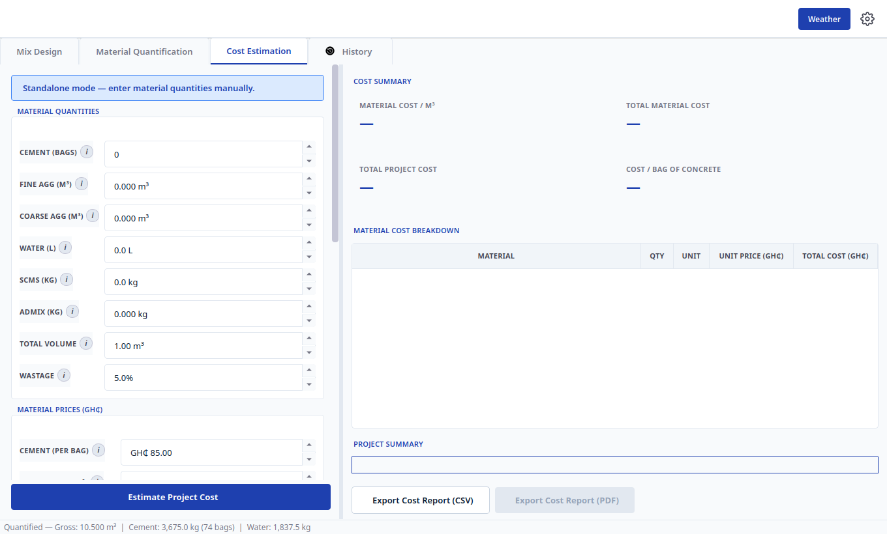
### 11.1 Group: `Material Quantities`

| Label | Range / default | Meaning |
|---|---|---|
| `Cement (Bags)` | 0–100000, default 0.0, integer | Bags = cement kg ÷ bag weight (50 kg). |
| `Fine Agg (m³/yd³)` | 0–100000, default 0.0, 3 dp | Sand volume. V = mass/(SG×1000). |
| `Coarse Agg (m³/yd³)` | 0–100000, default 0.0, 3 dp | Gravel volume. Bulk 1400–1700 kg/m³. |
| `Water (L/gal)` | 0–1000000, default 0.0, 1 dp | 1 kg = 1 L. Field ≠ design after moisture correction. |
| `SCMs (kg/lb)` | 0–100000, default 0.0, 1 dp | Fly ash/GGBFS/silica fume. |
| `Admix (kg/lb)` | 0–10000, default 0.0, 3 dp | Backend `total_admixture_kg` (1 L ≈ 1 kg). |
| `Total Volume (m³/yd³)` | 0.01–100000, default 1.0, 2 dp | Gross volume incl. wastage; denominator for unit cost. |
| `Wastage` | 0–30 %, default 5.0 %, suffix `%` | Handling/placing loss (typically 3–10 %). |

Auto-filled by quantify handoff; editable anytime (`valueChanged → _on_input_changed`).

### 11.2 Group: `Material Prices (GH₵)` (spins prefix `GH₵ `)

| Label | Default | Basis |
|---|---|---|
| `Cement (per bag)` | 85.00 (Ghana 60–120) | Per 50 kg bag, ex-transport. No unit conversion. |
| `Fine Agg (per m³/yd³)` | 350.00 | Delivered sand. |
| `Coarse Agg (per m³/yd³)` | 400.00 | Delivered gravel (10–20 % above sand). |
| `Water (per 1000L)` / `Water (per 1000 gal)` | 15.00 | Tanker/borehole/tap; 0 where free. |
| `Admixture (per kg/lb)` | 12.00 (range 8–25) | By type/brand. |

Button: `Reset to Default Prices` (secondary) → restores the five defaults above.

### 11.3 Group: `Additional Costs (GH₵ or %)` (currency rows prefix `GH₵ `)

| Label | Default | Meaning |
|---|---|---|
| `No. of Labourers` | 5.0 (0–100) | Headcount. |
| `Cost per Labourer (GH₵)` | 150.00 (Ghana 100–300/day) | Rate; total = count × rate. |
| `Transport (GH₵/m³)` | 80.00 | Delivery per volume. |
| `Plant/Overhead (%)` | 10.0 (0–50; typical 8–15) | Equipment/depreciation/supervision. |
| `Profit (%)` | 15.0 (0–50; typical 10–20) | Margin. |
| `Contingency (%)` | 5.0 (0–30; typical 3–10) | On subtotal. |

### 11.4 Group: `Project Information`

`Project Name` (placeholder `e.g., Terminal 3 Expansion`), `Location` (`e.g., Accra`), `Client` (`e.g., GAA`), `Date` (defaults today, calendar popup). Header for PDF/CSV; `Date` versions the prices.

### 11.5 Action + right panel

- Pinned: `  Estimate Project Cost` → calculates; `Invalid Volume` / `Total volume must be greater than zero.` if volume ≤ 0; `No Data` / `No cost estimate to preview. Please estimate costs first.` when previewing empty.
- `CostResultPanel`: `Cost Summary` cards (`Material Cost / m³|yd³`, `Total Material Cost`, `Total Project Cost`, `Cost / Bag of Concrete`, all `—` until calculated, unit `GH₵`); `Material Cost Breakdown` headers `Material` / `Qty` / `Unit` / `Unit Price (GH₵)` / `Total Cost (GH₵)`; `Project Summary`; buttons `  Export Cost Report (CSV)` + `  Export Cost Report (PDF)` (disabled until calculated). File dialogs: `Export Cost Report PDF` (default `cost_estimate.pdf`, `PDF (*.pdf)`), `Export Cost Report CSV` (default `cost_estimate.csv`, `CSV (*.csv)`); preview title `Cost Estimate Report Preview`; failure `PDF Export` / `Error exporting PDF: ...`.

---

## 12. `History` tab


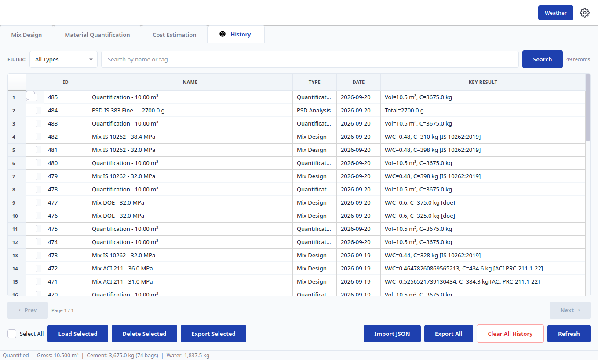
### 12.1 Filter bar

`Filter:` combo: `All Types`, `🏗 Mix Design`, `📏 Quantification`, `💰 Cost Estimation`, `🔬 PSD Analysis`, `🧪 DOE Trial Mix`, `🧪 ACI Trial Mix`. Search box placeholder `Search by name or tag...` (Enter = search) + `Search` button. Right stats: `{total} records`.

### 12.2 Table + pagination

Headers: `` (checkbox) / `ID` / `Name` / `Type` / `Date` / `Key Result`. Type cells show `Mix Design`, `Quantification`, `Cost Estimation`, `PSD Analysis`, `DOE Trial Mix`, `ACI Trial Mix`. Tooltips: `Pinned — stays at top. Right-click to unpin.`, `Pinned — stays at top. Right-click to unpin or rename.`, `Right-click to pin to top or rename.`

Pagination: `← Prev`, `Page {page} / {pages}`, `Next →`.

### 12.3 Bottom action bar

`Select All` checkbox + `Load Selected` (reloads into its tab: mix → `Mix Design`, bill → Quantify, costs → Cost, PSD → `PSD`), `Delete Selected`, `Export Selected`, `Import JSON`, `Export All`, `Clear All History` (red `danger-btn`), `Refresh`.

Right-click a row: `View Details`, `Load into Tab`, `📌 Pin to Top` / `📌 Unpin from Top`, `✏️ Rename…`, `Delete`.

### 12.4 Dialogs/messages (exact text)

- Import: `Import History` / `JSON Files (*.json)`; failure `Import Failed` / `Could not import '...'`; success `Import Complete` / `Imported N record(s).`
- Export: `Export History` (default `civilqntify_history.json`); `Export Selected` (default `civilqntify_selected.json`); success `Export Complete` / `Exported to ...` / `Exported N record(s) to ...`.
- Guards: `No Selection` / `No records selected. ...`; `Info` / `Cannot load record of type '...'`; `Confirm Delete` / `Delete N record(s)? This cannot be undone.`; `No History` / `There are no records to clear.`; `Clear All History` / `This will permanently delete all N record(s). This action cannot be undone. Continue?`; done `History Cleared` / `All history records have been deleted.`; rename `Rename History Entry` / `Custom name:`.

---


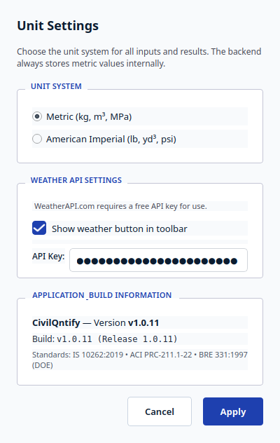
## 8. `Settings` dialog (`Settings`)

Heading `Unit Settings`; description `Choose the unit system for all inputs and results. The backend always stores metric values internally.`

- Group `Unit System`: `Metric (kg, m³, MPa)` / `American Imperial (lb, yd³, psi)` radios.
- Group `Weather API Settings`: `WeatherAPI.com requires a free API key for use. / Get your free key at: https://www.weatherapi.com/`; `Show weather button in toolbar` checkbox; `API Key:` field, placeholder `Enter your WeatherAPI.com API key` (password echo).
- Group `Application & Build Information`: `CivilQntify — Version {BUILD_TAG}`, `Build: {BUILD_TAG} (Release {__version__})`, `Standards: {STANDARDS_INFO}`.
- Buttons: `Cancel` → discard; `Apply` → save, relabel units everywhere, show/hide `Weather`.

---

## 9. `Weather Data` dialog (`Weather Data`, modal 560×700)

Hosts `WeatherWidget` with provider tabs `Open-Meteo (Free)` and `WeatherAPI.com`. Sections: `Current Conditions` cards (`Temperature`, `Feels Like`, `Humidity`, `Wind Speed`); `Precipitation: —` (runtime `Precipitation: {x:.1f} mm`); `5-Day Forecast`; `24-Hour Forecast`; per-day tabs with `Hourly` + day cards (`High`, `Low`, `Conditions`, `Rain`); day placeholders `—` before load.

Per provider tab: `Search:` + `Type city name...` box; `City:` combo items `{city} ({region})` from GHANA_CITIES; `Refresh` button. WeatherAPI tab adds `API Key: Not set (get free key at weatherapi.com)` ↔ `API Key: ✓ Set`. Status line starts `Select a city to view weather`; then `Fetching weather for {city}...`, `API key required. Set in Settings.`, `Weather data loaded`, `Error: {message}`, `Unable to load weather data`. Use it for hot/cold-weather concreting judgement (high temp + low humidity → plastic shrinkage risk; low temp → retarded set); it never changes a mix.

---

## 13. End-to-end workflows

### A. Characterize aggregates → design → bill → cost (recommended)

1. `Mix Design → PSD`: Setup → masses → `Compute & Plot` → `Use in Mix Design`.
2. `Concrete Mix Design`: Standard → Calculation → Steps 1–3 → `Calculate Mix Design`.
3. Result: check warnings → `Export PDF` → `Send to Quantification`.
4. `Material Quantification`: confirm Mode/elements/wastage → `Calculate Material Quantities` → handoff to Cost.
5. `Cost Estimation`: quantities → prices → additional → info → `Estimate Project Cost` → `Export Cost Report (PDF)`.
6. `History`: rename/pin; `Export All` for audit.

### B. Target strength only

`Calculation = Target Strength` → fill strength + margin inputs → `Calculate Target Strength` → read the target panel. No W/C or quantities.

### C. Nominal-ratio bill (no designed mix)

`Material Quantification → Mix Ratios & Volume` → Volume basis → preset/parts → factors → `Calculate Material Quantities`.

### D. Reuse history

`History`: filter/search → select → `Load Selected` (or `Load into Tab`) → recalculate or re-export.

---

## 14. Exports and files

- Mix: `Export CSV` (quantities + steps), `Export PDF` (via preview), PSD `Export Table CSV` (band-required sieves only) / `Export CSV` (computed) / `Export Image` (curve).
- Cost: `  Export Cost Report (CSV)` / `  Export Cost Report (PDF)`; history `Export Selected` / `Export All` / `Import JSON`.
- CSV/PDF include the header (`Project Name`, auto date), inputs, and clause steps for audit.

---

## 15. Troubleshooting

| Symptom | Cause / fix |
|---|---|
| `Use in Mix Design` disabled | No successful `Compute & Plot` yet (or BS lab checks unmet). Compute first. |
| `Export CSV` / `Export PDF` / `Send to Quantification` disabled | No result in the current mode. Calculate first. |
| `Invalid Volume` | Cost/quant volume ≤ 0. Enter a positive volume. |
| `No cost estimate to preview.` | `Estimate Project Cost` before preview/PDF. |
| `Cannot load record of type '...'` | Record type has no loader (e.g. trial view-only). Use `View Details` / export instead. |
| Exposure cap surprises (low W/C, high cement) | `Exposure Class` / `Max Free W/C Ratio` or ACI exposure combos are binding. Warnings banner names the governing clause. |
| DOE slump capped at 180 | By design (class 3 = 60–180 mm). Use Vebe for very stiff mixes. |
| `12.5 mm` NMSA missing | ACI/DOE disable it; switch `Standard` to IS 10262. |
| `CA Volume Fraction` vs `Grading Zone` confusion | Only one shows; the visible Table 5 row drives the engine. |

---

## 16. Solved standard examples (run in the GUI)

Each example below was set up field-by-field in `Mix Design → Concrete Mix Design` and calculated with `Calculate Mix Design`; the screenshots are the actual app output. Comparison tables use the per-m³ cards. Two app-wide policies explain every residual delta: targets round UP to whole MPa (§4.2 note in the form), and cement rounds UP to the nearest 5 kg (conservative).

### 16.1 IS 10262:2019 — Annex A example M40 (PPC, 20 mm, Severe, 75 mm slump)

Source: `IS-10262-2019-NewConcreteMix-design.md`, Annex A (stipulations A-1, target 48.25 N/mm², w/c 0.36, water 148 kg, cement 412 kg, FA 648 kg, CA 1234 kg, admixture 4.12 kg @ 1 %).

GUI inputs: `Standard = IS 10262:2019`, `Concrete Type = Reinforced Concrete`, `Exposure Class (IS 456) = Severe`, `Placing Method = Chute (non-pumpable)`, `Characteristic Strength fck = 40.00 MPa`, `Slump = 75 mm`, `NMSA = 20 mm`, `Cement Type = 42.5R (OPC 43)`, cement SG 2.88, `Grading Zone = II`, FA SG 2.65 / absorption 1.0 / moisture 0.0, `Aggregate Shape = Angular`, CA SG 2.74 / absorption 0.5 / moisture 0.0, admixture `Superplasticizer`, dosage 1.0 %, water reduction 23.0 %, SG 1.145.

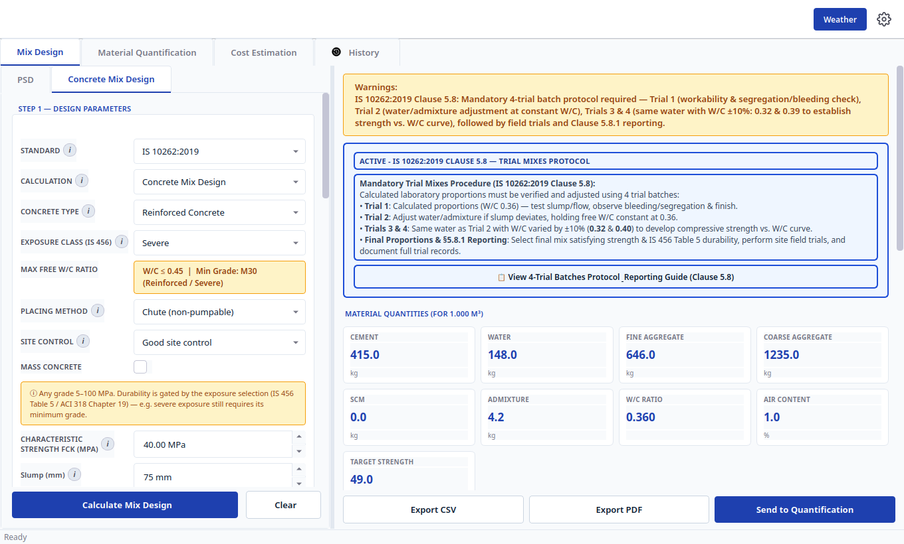

| Quantity | Standard (A-10) | App | Delta |
|---|---|---|---|
| Target mean strength | 48.25 MPa | 49.0 MPa | ceil-to-whole-MPa policy |
| Free W/C | 0.36 | 0.360 | exact |
| Water | 148 kg | 148.0 kg | exact |
| Cement | 412 kg | 415.0 kg | +3 (148 ÷ 0.36 = 411.1, rounded UP to 5 kg) |
| Fine aggregate | 648 kg | 646.0 kg | −2 |
| Coarse aggregate | 1234 kg | 1235.0 kg | +1 |
| Admixture (1 %) | 4.12 kg | 4.2 kg card (4.15) | scales with cement |
| Ratio | — | 1.0 : 1.6 : 3.0 (0.360) | — |

The result pane also raises the Clause 5.8 warning and the `ACTIVE - IS 10262:2019 CLAUSE 5.8 — TRIAL MIXES PROTOCOL` card (§7.3.1).

### 16.2 ACI PRC-211.1-22 — §9.2 Example 1 (2500 psi, 1½ in. rounded CA, FM 2.80)

Source: `31-ACI 211.1-22.md`, §9.2 Example 1 (Table 9.2.7.2 SSD proportions: water 300, cement 484, CA 1927, FA 1308 lb/yd³ at w/cm 0.62; Table 9.2.8 batched with 2 % / 6 % moisture).

GUI inputs: `Standard = ACI PRC-211.1:2022`, `Characteristic Strength fck = 17.24 MPa` (= 2500 psi), `Slump = 100 mm` (4 in., covers the 3–4 in. Table 5.3.3 row), `NMSA = 40 mm` (≈ 1½ in.), `Cement Type = 42.5N (Type I)`, `Fineness Modulus = 2.80`, FA SG 2.64 / absorption 0.7 / moisture 0.0, CA SG 2.68 / absorption 0.5 / moisture 0.0, `Dry-Rodded Bulk Density = 1602 kg/m³` (= 100 lb/ft³), `Air Entrainment` off, `S0` / `F0` / `W0` / `C0`, `Has Production Data` off (no prior tests → Table 4.7.4.1: f'c < 3000 psi ⇒ f'cr = f'c + 1000 psi = 3500 psi). `Rounded aggregate −8% water` left off, matching the example (300 lb unadjusted).

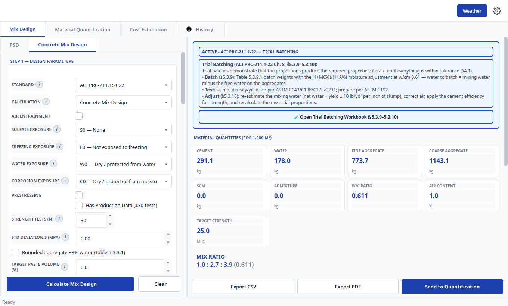

| Quantity | Standard (Table 9.2.7.2) | App | Delta |
|---|---|---|---|
| Target | 3500 psi = 24.13 MPa | 25.0 MPa | ceil policy |
| w/cm | 0.62 | 0.611 | Table 5.3.4 interpolated at 25 MPa instead of the exact 3500 psi row |
| Water | 300 lb/yd³ = 178.0 kg/m³ | 178.0 kg | exact |
| Cement | 484 lb/yd³ = 287.1 kg/m³ | 291.1 kg | +4.0 (178 ÷ 0.611) |
| Fine aggregate | 1308 lb/yd³ = 776.0 kg/m³ | 773.7 kg | −2.3 |
| Coarse aggregate | 1927 lb/yd³ = 1143.2 kg/m³ | 1143.1 kg | −0.1 |
| Ratio | — | 1.0 : 2.7 : 3.9 (0.611) | — |

The `ACTIVE - ACI PRC-211.1-22 — TRIAL BATCHING` card offers `🧪 Open Trial Batching Workbook (§5.3.9–5.3.10)` (§7.3.3). Re-running with aggregate moistures set reproduces the Table 9.2.8 batch-weight adjustment (water to batch = mixing water minus free moisture).

### 16.3 BRE 331:1997 (DOE) — §7.1 Example 1 (30 MPa, Class 42.5, 20 mm, 10–30 mm slump)

Source: `BRE-331-1997-DOE-Mix-Design.md`, §7.1 Example 1 (target 46 N/mm², w/c 0.47, water 160 kg, cement 340 kg, FA 515 kg, CA 1385 kg; max w/c 0.55, min cement 290 kg/m³, 70 % passing 600 µm, uncrushed 20 mm, RD 2.6).

GUI inputs: `Standard = DOE (BRE 331:1997)`, `Characteristic Strength fck = 30.0 MPa`, `Workability Range (DOE)` class 1 with `Slump = 20 mm`, `Number of Test Cubes (n) = 5` (n < 20 ⇒ Line A, s = 8 MPa — the example assumes no prior cube data), `Defective Percent = 2.5` (k = 1.96), `Cement Type = 42.5R`, `Coarse/Fine Aggregate Type = Uncrushed`, `FA Passing 600 µm = 70.0 %`, `Aggregate Rel. Density = 2.6`, `Min Cement = 290 kg/m³`, `Max W/C (Durability) = 0.55`, `Age = 28 Days`. `CA Split` stays `Single stock` (NMSA 20 auto-subdivides 10 + 20 mm at 1 : 2).

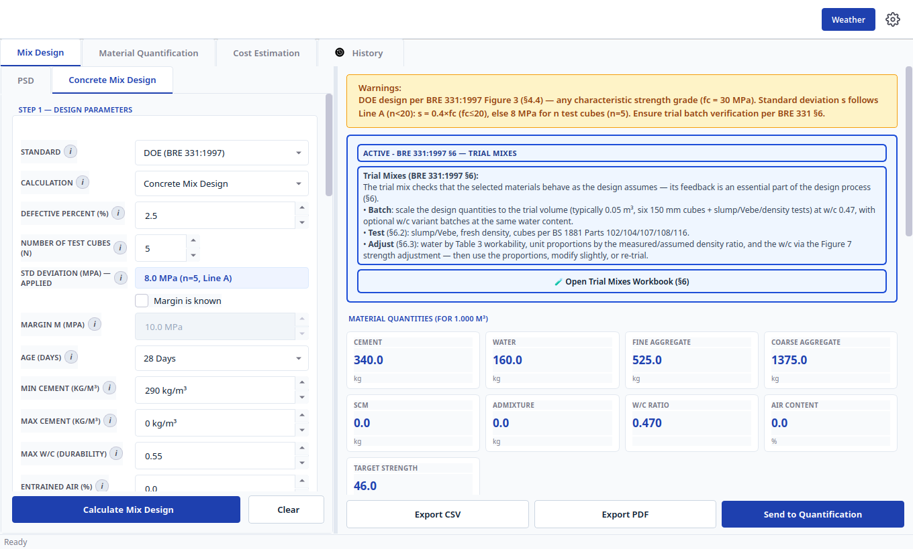

| Quantity | Standard (§7.1) | App | Delta |
|---|---|---|---|
| Target fm | 46 N/mm² | 46.0 MPa | exact (30 + 1.96 × 8 = 45.68, rounded up) |
| Free w/c | 0.47 | 0.470 | exact |
| Water | 160 kg | 160.0 kg | exact |
| Cement | 340 kg | 340.0 kg | exact (160 ÷ 0.47 = 340.4 → 340) |
| Fine aggregate | 515 kg | 525.0 kg | +10 (Figure 6 curve readout interpolation) |
| Coarse aggregate | 1385 kg | 1375.0 kg | −10 |
| Ratio | — | 1.0 : 1.5 : 4.0 (0.470) | — |

Leave `Number of Test Cubes` at its default 20 and the same inputs give the Line B answer instead (target 38, w/c 0.54, cement 295) — the GUI's `Std Deviation (MPa) — Applied` display always names the line in use, so a mismatch with a worked example is immediately visible.

---

## Appendix: label index (exact strings)

Main: `CivilQntify`, `Mix Design`, `Material Quantification`, `Cost Estimation`, `History`, `Weather`, `Unit Settings`, `Ready`, `Weather Data`, `Settings`, `Transfer Error`, `Load Error`.

Mix form groups: `Step 1 — Design Parameters`, `Step 2 — Material Properties`, `Step 3 — Admixtures & SCM`, `Trial Check (optional) — ACI §5.3.10`, `SCC Checks (optional, IS)`, `Report Details`. Buttons: `  Calculate Mix Design`, `  Calculate Target Strength`, `  Calculating...`, `  Clear`, `Export CSV`, `Export PDF`, `Send to Quantification`, `📋 View 4-Trial Batches Protocol & Reporting Guide (Clause 5.8)`, `🧪 Open Trial Mixes Workbook (§6)`, `🧪 Open Trial Batching Workbook (§5.3.9–5.3.10)`.

PSD: `Sieve Analysis — Setup`, `Standard`, `Aggregate Type`, `Reference Band`, `Input — Mass Retained on Each Sieve`, `Sieve Size`, `Mass Retained (g)`, `% Retained`, `Cumulative % Retained`, `% Passing`, `Standard % Passing`, `Export Table CSV`, `  Compute & Plot`, `  Clear`, `Quality Requirements`, `Results Summary`, `Gradation Curve (Semi-Log)`, `Gradation Analysis`, `Fineness Modulus — from Sieve Analysis (ACI 211.1-22 §4.3.5)`, `Use in Mix Design`, `Export CSV`, `Export Image`, `OK`.

Quantify: `Design Mix Proportions`, `Mix Ratios & Volume`, `Quantification Basis`, `Total Volume`, `Structural Elements`, `Add Element`, `Remove Selected`, `Wastage`, `Mix Design Parameters (per m³)`, `Mix Information`, `Override Mix Values (per m³)`, `Reset All Overrides`, `  Calculate Material Quantities`, `Volume of Work Basis`, `Total Volume of Work`, `Mix Proportions (Cement : Sand : Coarse Agg)`, `Factors & Material Constants`.

Cost: `Material Quantities`, `Material Prices (GH₵)`, `Reset to Default Prices`, `Additional Costs (GH₵ or %)`, `Project Information`, `  Estimate Project Cost`, `Cost Summary`, `Material Cost Breakdown`, `Project Summary`, `  Export Cost Report (CSV)`, `  Export Cost Report (PDF)`.

History: `Filter:`, `Search`, `← Prev`, `Next →`, `Select All`, `Load Selected`, `Delete Selected`, `Export Selected`, `Import JSON`, `Export All`, `Clear All History`, `Refresh`.

Trial workbooks: `IS 10262:2019 Clause 5.8 — Trial Mixes Protocol & Reporting`, `IS 10262:2019 Section 5.8 — Trial Mixes Procedure`, `Mandatory 4-Trial Batches Schedule (Clause 5.8)`, `Clause 5.8 Step-by-Step Lab & Field Procedure`, `Clause 5.8.1 Mandatory Reporting Checklist`, `Copy Trial Batches to Clipboard`, `Export Trial Batches (CSV)`, `DOE (BRE 331:1997) §6 — Trial Mixes Workbook`, `BRE 331:1997 §6 — Trial Mixes`, `Trial Batch Schedule (§6.1)`, `Trial volume (m³):`, `Add ±w/c variant batches`, `w/c step:`, `Aggregate moisture condition (BS 1881 Part 125):`, `Trial Results & §6.3 Adjustments`, `Tests on Trial Mixes — §6.2 Checklist`, `ACI PRC-211.1-22 — Trial Batching Workbook`, `ACI PRC-211.1-22 — Trial Batching (Ch. 8, §5.3.9–5.3.10)`, `Batch Weight Summary (§5.3.9, Table 5.3.9.1)`, `Add A.5 trial series (±cementitious)`, `Cement step (%):`, `Trial Results & §5.3.10 Post-Trial Adjustments`, `Trial Batch Tests — ASTM Checklist (Ch. 8 / §5.3.10)`, `Calculate Adjustments`, `Save Trial Record`, `Copy Schedule to Clipboard`, `Export Workbook (CSV)`, `Close`.

Settings: `Unit Settings`, `Unit System`, `Metric (kg, m³, MPa)`, `American Imperial (lb, yd³, psi)`, `Weather API Settings`, `Show weather button in toolbar`, `API Key:`, `Application & Build Information`, `Cancel`, `Apply`.

Weather: `Weather Data`, `Open-Meteo (Free)`, `WeatherAPI.com`, `Current Conditions`, `5-Day Forecast`, `24-Hour Forecast`, `Search:`, `City:`, `Refresh`.
